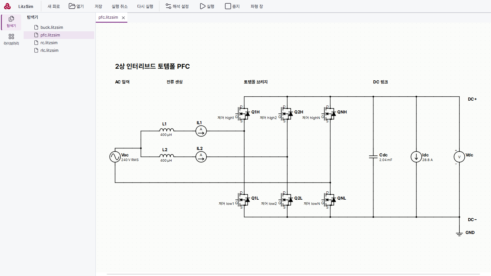

# LitzSim · 리츠심

사람과 AI가 같은 회로도를 편집하고 실험을 재현하는 오픈소스 전력전자 시뮬레이터를 개발합니다.

첫 예제는 양방향 온보드 충전기(OBC)입니다. 엔지니어가 회로에서 선택한 가지에 AI가 센서나 필터를 넣고, 변경한 회로에서 스위칭 모델과 평균 모델의 응답을 비교하는 것이 목표입니다.

Qt 편집기에서 [RC](examples/rc.litzsim), [RLC](examples/rlc.litzsim), [벅](examples/buck.litzsim), [2상 토템폴 PFC](examples/pfc.litzsim) 예제를 열고 실행할 수 있습니다. 단자 이름은 `소자ID.핀` 형식이며 전압·전류 프로브의 기준 방향은 p에서 n입니다. 연결은 nets, 격자 위치는 layout, 적분 간격과 종료 시각은 simulation에서 관리합니다.

Qt 6 Core·Widgets·Svg·Test와 SVG 아이콘 플러그인, C++17 컴파일러와 CMake로 빌드합니다. 아래는 Windows의 단일 구성 Release 빌드 예입니다. MSYS2 UCRT64의 `bin`은 빌드할 때 PATH에 추가합니다. Windows MinGW 빌드는 실행 파일 옆에 Qt·컴파일러 DLL과 플랫폼 플러그인을 배치합니다. 빌드 후에는 탐색기에서 `build\litzsim.exe`를 더블클릭해 실행할 수 있습니다. 다른 폴더로 옮길 때는 `litzsim-cli.exe`, DLL과 플러그인 하위 폴더도 함께 옮깁니다.

```powershell
cmake -S . -B build -G Ninja -DCMAKE_BUILD_TYPE=Release
cmake --build build
ctest --test-dir build --output-on-failure
./build/litzsim-cli inspect examples/rc.litzsim
./build/litzsim-cli run examples/buck.litzsim build/buck.csv
./build/litzsim-cli export examples/buck.litzsim build/buck.pdf --width-mm 182
./build/litzsim examples/pfc.litzsim
```

라이브러리에서 부품을 누르거나 캔버스에 놓고, 두 단자를 차례로 눌러 연결합니다. 소자를 끌어 이동하고 선택 후 R로 회전합니다. 값을 더블클릭해 수정하고 Ctrl+Z로 되돌립니다. F5는 현재 탭을 실행하고 Shift+F5는 중지합니다. 회로 옆 `runs` 폴더에 실행 시점의 회로·설정과 결과를 보관합니다. 결과 창에서 휠로 시간축을, Shift+휠로 세로축을 확대하고 끌어서 이동합니다. 빈 plot을 추가한 뒤 신호 겹치기에서 실행·X·Y·오른쪽 축을 선택할 수 있습니다.

회로도는 IEEE 315 계열 기호를 사용합니다. 기호와 배선은 기본 검정이며, 전압 프로브의 +/−는 p/n 단자에, 전류 프로브의 화살표는 p→n 기준 방향에 대응합니다. PFC의 제어기 구동 게이트에는 단자 옆에 신호 이름이 표시됩니다. [기호표와 예제별 전후 캡처](docs/spikes/2026-11-25-schematic-publication-audit.md#이슈-15-기호와-측정-표기)

연결된 분기는 채운 점으로 표시합니다. 서로 다른 네트의 직교 교차에서는 세로선이 교차점을 지나고 가로선이 위로 반원을 그려 넘어갑니다. 배선은 소자와 단자 라벨을 피해 그립니다. [RC·벅·PFC 배선 전후 캡처](docs/spikes/2026-11-25-schematic-publication-audit.md#이슈-16-배선과-비접속-교차)

도구 모음의 **회로도 내보내기**에서 SVG 또는 PDF와 최종 폭(mm)을 지정합니다. 기본 출력은 제목과 구역 주석을 제외한 흰 배경의 회로도입니다. 제목과 구역 주석은 **도면 제목 및 구역 주석 포함** 또는 CLI의 `--annotations`로 추가합니다. 소자 ID와 극성은 9 pt 굵게, 값·단자명·게이트 신호명은 8 pt로 그립니다. PDF 글자는 벡터 윤곽선이고 SVG 글자는 편집할 수 있는 텍스트입니다. [예제별 미리보기와 측정값](docs/spikes/2026-11-25-schematic-publication-audit.md#이슈-17-논문용-벡터-내보내기)



해석 설정에서 결과 저장 간격을 time-step의 정수 배로 지정할 수 있습니다. 예를 들어 time-step이 1 µs이고 저장 간격이 7 µs이면 0, 7, 14 µs 순으로 기록하며 종료 시각의 표본도 보관합니다. JSON 필드는 `simulation.outputStep_s`입니다. 비워 두면 기존 파일처럼 해석기가 내보내는 모든 표본을 저장합니다.

[검증 조건과 측정값](docs/reviews/pfc-validation.md) · [리치오 화면 비교](docs/reviews/desktop-shell.md)

[제품 목적](docs/purpose.md) · [에이전트 작업 안내](AGENTS.md)
