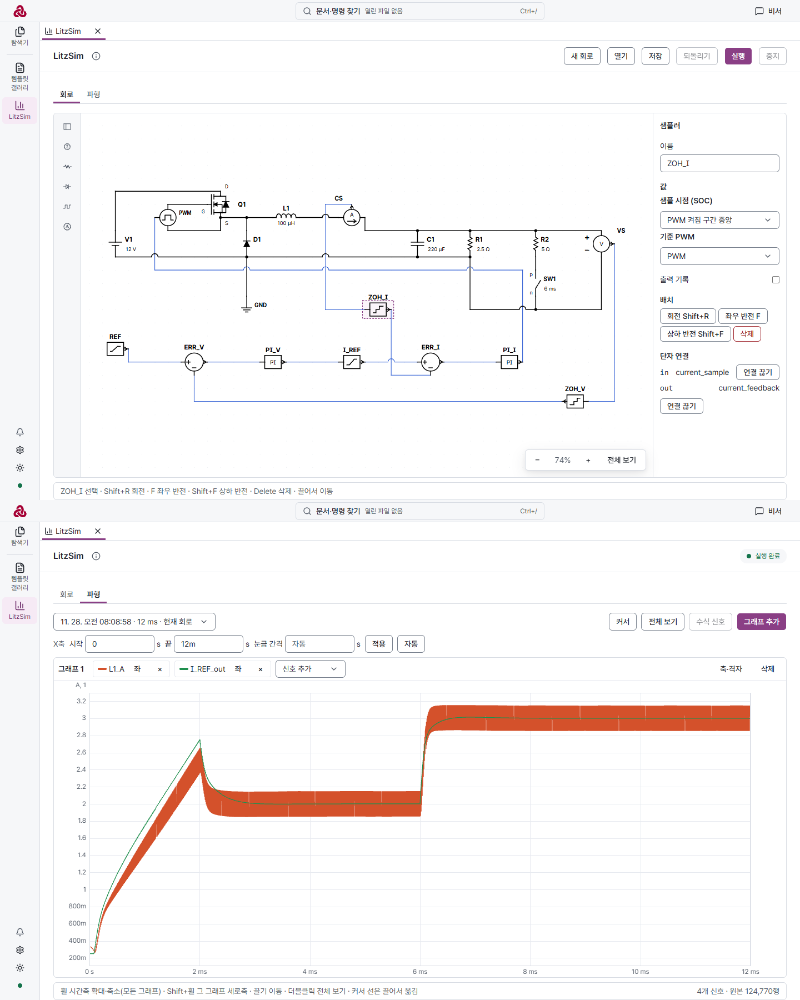

# 이중루프 벅 검증 기록

Windows x64, AMD Ryzen 5 5600X, Rust `stable-x86_64-pc-windows-gnu` Release. [사전 합격 기준](buck-dual-loop-criteria.md)은 기존 기준 `af18fe2`와 SOC 추가 기준 `11cceeb`에서 고정했다. [회로 파일](../../examples/buck-dual-loop.litzsim)과 [검증 시험](../../crates/litzsim-core/tests/buck_dual_loop.rs)을 사용했다.

## 회로와 제어기

12 V 입력의 이상 CCM 벅에서 100 µH와 220 µF(ESR 0 Ω)를 사용했다. 초기 전압과 PI 적분 상태는 0, 인덕터 초기 전류는 0.25 A다. 5 V까지 2 ms 동안 지령을 올린다. 6 ms에서 2.5 Ω 기본 부하에 5 Ω을 병렬 연결해 정격 전류를 2 A에서 3 A로 늘린다. 5 V, 100 kHz에서 예상 인덕터 전류 리플은 0.29 A p-p다.

PWM 캐리어가 시작될 때 10 µs마다 태스크를 실행한다. 전압 센서는 같은 시각에 샘플해 전압 PI에 최신 측정을 바로 전달하며 기존 계산 시각을 유지한다. 전류 센서는 실제 적용 듀티의 켜짐 구간 중앙에서 샘플한다. 다음 태스크가 이 값을 소비한다. CCM에서 거의 선형인 전류 리플의 켜짐 중앙은 주기 평균에 해당한다. 전류 지령 `I_REF_out`을 기록 채널에 추가했다.

두 PI의 이득과 제한은 동일하게 사용했다. 전류 루프는 Vᵢₙ/(Ls) 근사에서 5 kHz 교차, 500 Hz 영점을 목표로 Kp 0.262와 Ki 823을 쓰며 듀티를 0–0.9로 제한한다. 전압 루프는 1/(Cs) 근사에서 1.6 kHz 교차, 600 Hz 영점을 목표로 Kp 2.212와 Ki 8338을 쓰며 전류 지령을 0.25–4 A로 제한한다.

## 수치 결과

독립 평균 모델은 주기마다 dI/dt = (12D − V)/L, dV/dt = (I − V/R)/C를 80개 고정 RK4 스텝으로 적분한다. 초기 상태, 전압 샘플 시각, 두 PI의 차분식과 이득, 지령 및 부하 전환은 스위칭 모델과 같다. 평균 모델은 스위칭 리플을 생략하므로 전류 측정을 직전 PWM 주기 평균으로 근사한다. 첫 태스크의 전류 샘플러 출력은 두 모델에서 0이다. 원본 파형의 왼쪽·오른쪽 극한을 보존하고 사다리꼴 적분으로 주기 평균을 계산했다.

| 시험 | 조건 | 관측값 |
| --- | --- | --- |
| CCM | 기본 스텝 0.1 µs, 0–12 ms | 인덕터 전류 최솟값 0.250000 A |
| 전환 전 정상상태 | 5–6 ms, 2.5 Ω | 출력 5.000204 V, 인덕터 2.000102 A, 부하 2.000082 A, 전류 지령 2.000094 A |
| 전환 후 정상상태 | 10–12 ms, 2.5 Ω ∥ 5 Ω | 출력 5.000221 V, 인덕터 3.000144 A, 부하 3.000132 A, 전류 지령 3.000145 A |
| 전류 지령 추종 | 5–6 ms, 10–12 ms의 창 평균 차이 | 약 +0.0079 mA, −0.00043 mA. 창에 속한 개별 PWM 주기도 각각 ±5 mA 이내 |
| 부하 계단 | 6–12 ms, 600개 PWM 주기 | 스위칭·평균 기준의 주기 평균 RMSE는 전압 0.806 mV, 전류 2.338 mA, 듀티 0.0373 퍼센트포인트 |
| 언더슈트와 회복 | 5 V 대비 최저 주기 평균과 ±50 mV 지속 진입 시각 | 스위칭 264.399 mV, 0.72 ms. 평균 기준 270.270 mV, 0.72 ms |
| 수치 수렴 | 0–12 ms, 스텝 0.2→0.1→0.05 µs | 인접 해의 주기 평균 RMSE는 전압 33.76→17.14 µV, 전류 85.50→26.51 µA, 듀티 7.63×10⁻⁶→3.77×10⁻⁶ |

동일 전력단·제어 이득·초기조건·기록 채널을 쓴 변경 전 main `4bd3aa7`은 5–6 ms와 10–12 ms에서 각각 +145.857 mA와 +145.849 mA를 보였다. 두 샘플러의 SOC를 기존 주기 시작으로 지정한 v2 회로의 파형은 main과 바이트 단위로 일치했다. `buck`, `rc`, `rlc`, `rc-load-step`, `buck-probe`와 제어 예제 `control-signals`, `buck-voltage-loop`도 파일 전체가 일치했다. 보관 `pfc` 입력은 `control` 필드에서 같은 진단을 반환했다.

동일 조건에서 CLI 실행의 경과 시간을 비교했다. 0.1 µs 기본 스텝으로 12 ms를 계산했고 프로세스 시작, 회로 읽기, 해석과 원본 파형 파일 쓰기를 포함했다. 세 경우를 교차 실행하고 첫 회를 제외한 9회씩의 중앙값을 취했다. main의 골 샘플은 175.51 ms, v2의 골 샘플은 174.88 ms, v2의 켜짐 중앙 샘플은 175.52 ms였다. 측정 범위는 각각 169.69–229.65 ms, 170.01–188.13 ms, 173.41–196.11 ms였다.

## Litzio 화면에서 실행

격리한 Litzio 0.0.4-beta.3 Host(`d952b460f7f9`)에 로컬 플러그인을 등록했다. Windows Edge 밝은 테마 1440×900에서 라이브러리로 샘플러를 배치하고 SOC 모드를 바꿨다. 제어 태스크의 고정 주기 모드와 위상 편집 후 되돌리기로 PWM 동기 설정을 복원했다. 이중루프 벅의 선택된 `ZOH_I`에서 PWM 켜짐 구간 중앙을 확인했다. 센서 극성·전류 방향, 배선, 라벨을 확인했고 코어 도면 진단은 0건이었다.

실행 원본 124,770행에서 `L1_A`와 `I_REF_out`을 같은 세로 축에 표시해 2 ms 램프 종료와 6 ms 부하 계단 전후의 전류 리플과 지령을 확인했다. 아래 이미지는 같은 세션의 회로 탭과 파형 탭을 각각 1440×900으로 캡처해 위아래로 붙였다. 검증용 플러그인을 등록 해제하고 검증 Host·Edge·LitzSim 프로세스가 종료됐음을 확인했다.

## 검증 범위

한 CCM 운전점의 이상 스위칭·평균 모델과 전압 고정 CCM 해석해를 비교했다. 실기·PSIM 파형, 소자 손실과 기생성분, 루프 이득 실측, 다른 운전점의 정확도와 실행시간은 별도 검증이 필요하다.

이전 검증에서 [#88](https://github.com/litzio/litzsim/issues/88)을 별도 입력으로 재현했다. 단일 전압 루프 벅의 5 V 입력에 10 Ω–시간 스위치–접지 가지를 추가하고 전압 센서를 스위치 양단에 연결했다. 영전류 상태에서 종료 시각 999 µs는 성공했고, 1.2 ms 실행은 스위치가 닫히는 1 ms에 `singularCircuit`과 인덕터 귀로 진단으로 종료됐다.
