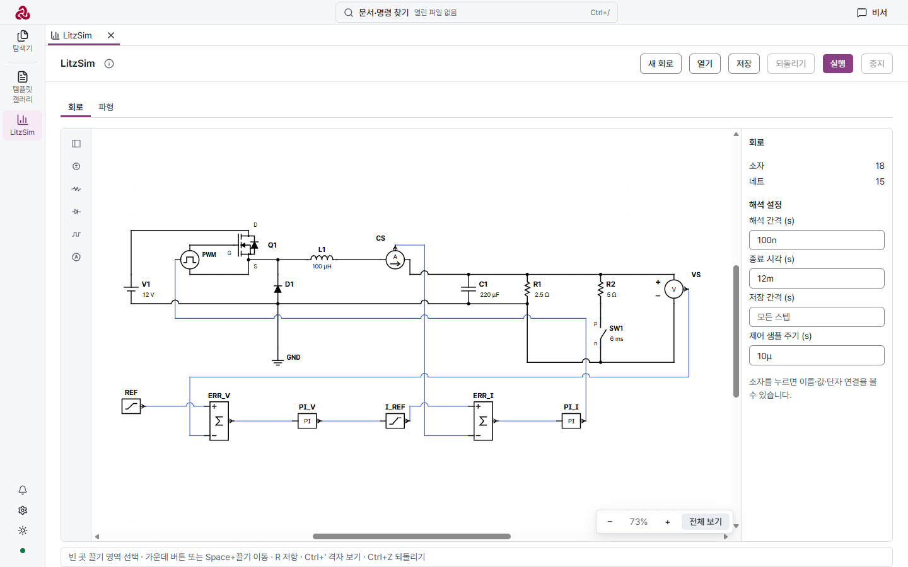
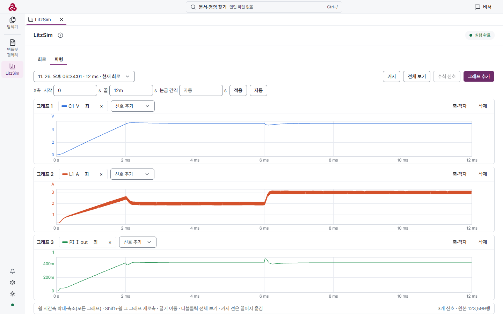

# 이중루프 벅 검증 기록

Windows x64, AMD Ryzen 5 5600X, Rust `stable-x86_64-pc-windows-gnu` Release. [사전 합격 기준](buck-dual-loop-criteria.md)을 `af18fe2`에서 고정했다. [회로 파일](../../examples/buck-dual-loop.litzsim)과 [검증 시험](../../crates/litzsim-core/tests/buck_dual_loop.rs)은 같은 전력단·이산 제어·초기조건을 사용한다.

## 회로와 제어기

12 V 입력의 이상 CCM 벅에서 100 µH와 220 µF(ESR 0 Ω)를 사용했다. 초기 전압과 PI 적분 상태는 0, 인덕터 초기 전류는 0.25 A다. 5 V까지 2 ms 동안 지령을 올린다. 6 ms에서 2.5 Ω 기본 부하에 5 Ω을 병렬 연결해 정격 전류를 2 A에서 3 A로 늘린다. 5 V, 100 kHz에서 예상 인덕터 전류 리플은 0.29 A p-p다.

두 PI는 PWM과 같은 10 µs 주기로 샘플링한다. 전압 PI의 출력과 전류 지령 리미터는 0.25–4 A, 전류 PI의 출력은 듀티 0–0.9로 제한했다. 전류 루프는 Vᵢₙ/(Ls) 근사에서 교차 주파수 목표 5 kHz, PI 영점 500 Hz로 Kp 0.262, Ki 823을 사용했다.

전압 루프의 첫 설계(교차 주파수 목표 800 Hz, 영점 300 Hz)는 전압 강하 429.8 mV와 회복 2.01 ms를 보였다. 부하 계단에 더 빨리 반응하도록 1/(Cs) 근사에서 교차 주파수 목표를 1.6 kHz로, 영점을 600 Hz로 옮겼다. Kp = 2π·1600·C ≈ 2.212, Ki = Kp·2π·600 ≈ 8338을 스위칭 예제와 평균 기준에 적용했다. 교차 주파수는 이득 산정에 사용한 목표값이다. 사전 합격 기준은 유지했다.

## 수치 결과

독립 평균 모델은 주기마다 dI/dt = (12D − V)/L, dV/dt = (I − V/R)/C를 80개 고정 RK4 스텝으로 적분한다. 두 모델은 같은 초기 전압·전류, 제어기 차분식, 샘플 시각, 지령과 부하 전환을 쓴다. 스위칭 파형은 중복 시각의 두 극한을 보존한 원본 행에서 사다리꼴 적분으로 주기 평균을 계산한다.

| 시험 | 조건 | 관측값 |
| --- | --- | --- |
| CCM | 기본 스텝 0.1 µs, 0–12 ms | 인덕터 전류 최솟값 0.235279 A |
| 전환 전 정상상태 | 5–6 ms, 2.5 Ω | 출력 5.000205 V, 인덕터 2.000093 A, 평균 전압으로 계산한 부하 전류 2.000082 A |
| 전환 후 정상상태 | 10–12 ms, 2.5 Ω ∥ 5 Ω | 출력 5.000221 V, 인덕터 3.000134 A, 부하 전류 3.000133 A |
| 부하 계단 | 6–12 ms, 600개 PWM 주기 | 스위칭·평균 기준의 주기 평균 RMSE는 전압 0.282 mV, 전류 0.564 mA, 듀티 0.00517 퍼센트포인트 |
| 언더슈트와 회복 | 5 V 대비 최저 주기 평균과 ±50 mV 지속 진입 시각 | 스위칭 279.629 mV, 0.71 ms. 평균 기준 280.742 mV, 0.71 ms |
| 수치 수렴 | 0–12 ms, 스텝 0.2→0.1→0.05 µs | 인접 해의 주기 평균 RMSE는 전압 34.71→17.33 µV, 전류 47.82→23.60 µA, 듀티 7.25×10⁻⁶→3.64×10⁻⁶ |

단독 시험 1회에서 스위칭 모델은 0.2/0.1/0.05 µs 순으로 76.3/138.9/255.0 ms, 파형 통계까지 78.0/141.7/258.9 ms였다. 평균 기준은 주기별 집계를 포함해 3.35 ms였다. 스위칭 시간에는 메모리 내 파형 생성이 포함되며 회로 파싱, 파일 쓰기, 프로세스 시작과 화면 표시는 제외한다. 시험 전체는 0.48 s였다. 기존 단일 루프 추종과 에지 계약 시험에 더해, 이 시험은 두 폐루프를 모두 포함한 CCM 부하 계단의 응답과 스텝 수렴을 검사한다.

`cargo build --release`, `cargo test --release`(97개), `cargo xtask plugin`, `node --test plugin/rules.test.mjs`(20개)가 통과했다. main `26456fcb2dd9`과 이 브랜치의 별도 Release 빌드로 같은 기존 입력을 실행했다. `buck`, `buck-probe`, `buck-voltage-loop`, `control-signals`, `rc`, `rc-load-step`, `rlc`의 파형 파일 전체가 바이트 단위로 일치했다. 보관 `pfc` 입력은 양쪽에서 `control` 필드를 같은 오류로 거절했다.

## Litzio 화면에서 실행

격리한 Litzio 0.0.4-beta.3 Host(`37feba2ebfd4`)에 로컬 플러그인을 등록했다. Windows Edge 밝은 테마, 1440×900에서 회로 파일을 열고 극성 표시, 전류 센서 화살표, 신호선과 전기선의 교차 및 라벨을 확인했다. 코어 도면 진단은 0건이었다.

실행을 완료한 뒤 파형 탭에서 원본 123,599행의 `C1_V`, `L1_A`, `PI_I_out`을 전압·전류·듀티 그래프에 각각 표시했다. 2 ms 램프 종료와 6 ms 부하 계단, 신호 범례와 축을 확인했다. 검증용 플러그인을 등록 해제하고 격리 Host·브라우저·LitzSim 자식 프로세스가 종료됐음을 확인했다.

## 검증 범위

한 CCM 운전점의 이상 스위칭·평균 모델을 비교했다. 실기·PSIM 파형, 소자 손실과 기생성분, 루프 이득 실측, 다른 운전점의 정확도와 실행시간은 별도 검증이 필요하다.

[#88](https://github.com/litzio/litzsim/issues/88)은 별도 입력에서 재현했다. 단일 전압 루프 벅의 5 V 입력에 10 Ω–시간 스위치–접지 가지를 추가하고 전압 센서를 스위치 양단에 연결했다. 영전류 상태에서 종료 시각 999 µs는 성공했고, 1.2 ms 실행은 스위치가 닫히는 1 ms에 `singularCircuit`과 인덕터 귀로 진단으로 종료됐다.
