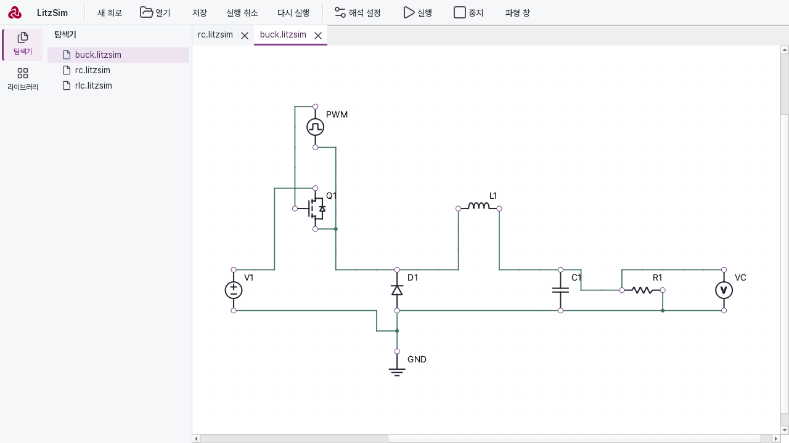
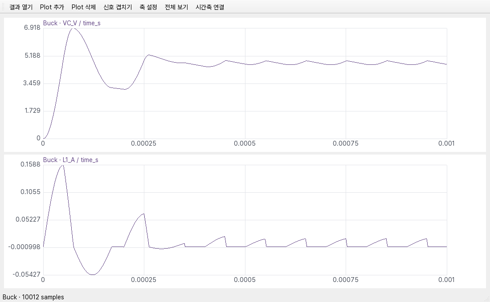

# 리치오와 LitzSim 화면 검토

리치오 웹 에디터 dee008ac를 로컬에서 실행해 document-tabs 시나리오의 1280×720 화면을 확인했다. 시나리오 전체는 탭 닫기 조작에서 시간 초과했다. 화면 구조를 비교하는 데 해당 캡처를 사용했다. 한국어 표기는 [리치오 제품 캡처](https://github.com/litzio/litzio/blob/dee008ac/docs/design/assets/activity-bar-1877/1440-show-light.png)도 함께 확인했다. LitzSim 편집기는 Windows Qt 6 Release 및 offscreen 플랫폼의 1280×720 캡처다. 언어와 렌더러가 달라 픽셀 일치 판정은 하지 않았다.

| 관찰 | LitzSim 변경 및 판단 |
| --- | --- |
| 리치오는 40px 제목 줄, 아이콘과 이름을 함께 보여주는 72px Activity bar, 탐색기 제목을 사용한다. 초기 Qt 창은 제목과 선택 표시가 약하고 글자 버튼만 있었다. | 제목·Activity bar·탐색기 머리말을 분리하고 활성 항목에 세로 강조선을 넣었다. Qt로 구현 가능하다. |
| 활성 파일은 탭 하단 강조선으로 구분한다. Qt 기본 탭은 배경색과 플랫폼 닫기 아이콘에 의존했다. | 하단 강조선과 Lucide 닫기 아이콘을 적용했다. 미저장 탭 표시, 키보드 포커스와 고배율 모니터는 추가 검토 대상이다. |
| 초기 Qt 캡처의 기본 글꼴이 Agency FB로 선택되어 숫자 폭이 지나치게 좁았다. | Pretendard Variable 1.3.9를 앱에 포함하고 14px로 지정했다. 런타임에서 글꼴 이름과 픽셀 크기를 확인했다. |
| 리치오의 중앙은 문서 작업면이다. | LitzSim의 중앙은 회로 격자로 유지한다. 상단 실행·중지, 독립 결과 창도 전력전자 작업을 위한 의도적 차이다. |
| 동일 SVG·글꼴을 양쪽 렌더러에서 활성화할 수 있었다. | 검토한 차이에서 Qt 구현을 막는 제약은 발견하지 않았다. Electron/Chromium과 Qt의 OS 제목줄, 픽셀 힌팅, 고DPI 동작의 동등성은 미검증이다. |

Windows 창 아이콘과 브랜드 마크는 리치오의 `apps/desktop/assets/icon.ico`, 탐색기 아이콘은 리치오 ActivityBar의 Lucide Files다. 라이브러리는 동일 패키지의 LayoutGrid를 선택했다. 라이선스 원문은 `assets/icons`와 `assets/fonts`에 있다.

재촬영은 빌드 후 `viewer-test examples <기존 출력 폴더>`로 수행한다. 대용량 시험은 뒤에 `bench` 인자를 추가한다. 1,000만 행 × 8개 신호, 4개 시간 plot, 1280×780 오프스크린 렌더, Windows Ryzen 5 5600X·32 GiB에서 프레임 시간을 측정한다. 파일 생성 직후의 OS 캐시가 적용되며 실제 모니터 표시 지연과 cold-start SSD 지연은 별도다.
