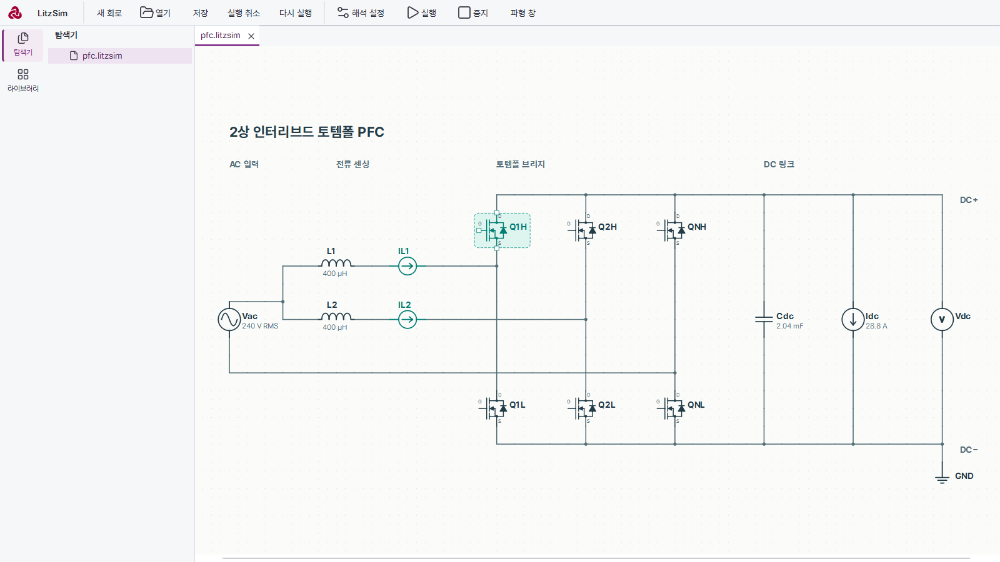
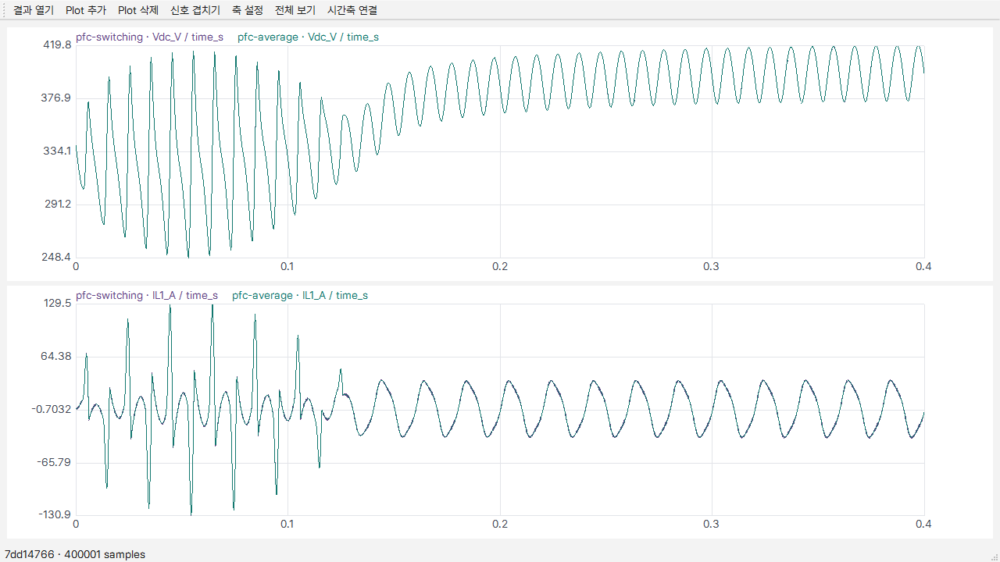

# Windows MVP 검증 기록

C++17 UCRT64 GCC 15.2, Qt 6.10.1, CMake Ninja Release. 로컬 실행은 README의 CTest 명령을 사용한다. GPU 가속과 CI는 사용하지 않았다.

| 시험 | 조건 | 관측값 |
| --- | --- | --- |
| RC / RLC | 5 V 계단, 0–5 ms. 초기 커패시터 전압·인덕터 전류 0. 파일의 회로 연결로 조립한 MNA와 후진 오일러 해석 | 10 → 5 → 2.5 µs에서 최대 전압 오차가 RC 9.159 → 4.589 → 2.297 mV, 직렬 RLC 19.435 → 9.751 → 4.884 mV로 감소했다. |
| 이상 벅 | 5 V 입력, 3 V 고정 출력, 1 mH, 10 kHz 및 듀티 0.5. 0.37 µs 스텝에서 에지를 분리. 초기 전류 0.2/0 A | 한 주기에서 전류 피크 0.30/0.10 A. DCM 첫 영전류 샘플 83.67 µs, 구간 기준해 83.33 µs. 검증 범위는 이상 스위치와 지정 출력 전압이다. |
| 2상 토템폴 PFC | 240 V RMS·50 Hz, 400 µH 두 상·2,040 µF 링크, 초기 0 A·339.41 V. 목표 400 V, 28.8 A 정전류 부하. 62.5 kHz 180° PWM, 16 µs 제어 샘플, 1 µs 기록, 0.4 s | 25,000개 PWM 주기 각각에 대해 사다리꼴 평균 후 RMSE가 두 상에서 각각 0.00018 A, 링크에서 0.00032 V였다. 스위칭 모델 계통전류 절댓값 최대 264.48 A, 링크 최저 248.45 V. 적분한 전력과 저장에너지 변화의 최대 잔차는 4.8×10⁻⁹ J였다. |
| 대용량 파형 | Ryzen 5 5600X, 32 GiB, Samsung SSD 980 PRO, Release, warm OS cache. 시간 열 + 8개 신호, 1,000만 행. CSV는 238,888,914바이트의 단일 피크 합성 데이터 | 최초 CSV 변환 11.34 s. 준비된 결과의 별도 4신호 렌더 벤치마크는 1280×780, 3회 실행에서 첫 4개 plot 표시 282–334 ms, 실행당 50회 범위 이동 렌더 p95 10.29–11.18 ms였다. 동일 시험 프로세스의 피크 working set은 519.3–519.4 MiB였다. 오프스크린 QWidget 렌더 시간이며 모니터 표시 지연, cold cache, 임의 XY 및 복잡한 CSV는 별도다. |

PFC 두 실행은 동일 회로·제어기·초기조건·부하를 사용하며 같은 시간축에서 비교했다. 스위칭 모델은 삼각파와 듀티의 교점을 이용해 구간을 나누고, 평균 모델은 같은 시간 동안의 듀티를 적용한다. 선행 연속 제어기와 달리 이 예제의 제어기는 PWM 주기마다 한 번 갱신한다. 모델 간 오차로 PSIM·실기에 대한 절대 정확도를 판단할 수 없다. 기동부터 정전류 전부하를 요구한 비교 조건이므로 큰 기동 전류와 링크 강하가 나타난다. 부하 램프 기동은 후속 시험이다.

이 PFC 해석은 파일의 소자 ID·단자 접속·극성·게이트 배정을 확인한 뒤 해당 토폴로지의 축약 방정식을 구성한다. 인덕턴스·초기조건 등 파일 값을 반영하고 지원하지 않는 결선 변경은 오류로 처리한다. MOSFET 손실·기생 소자·데드타임·변형 토폴로지 해석과 CLLLC는 이 검증 범위 밖이다.

## 화면에서 바꾼 회로 실행

통합 시험은 회로 편집기에 PFC를 열고 Q1H 선택을 실제 클릭으로 확인한다. L1을 410 µH로 수정하고 400 µH인 L2는 유지한 채 스위칭·평균 두 실행의 스냅샷과 각각 400,001개 표본을 검사한다. 아래 파형은 이 편집본이며, 위 표의 두 상 400 µH 시험과 조건이 다르다.

소자 표시는 선행 PySide6 편집기에서 사용한 분할 채널 NMOS·소스 결합 몸체 화살표·바디 다이오드, 전류 센서의 화살표, 소자 ID·값 분리와 수평 DC 버스 배치를 C++ Qt로 옮겼다. 접속점은 네트에서 그리며 단자 핸들은 선택과 배선 중에 표시한다. 사용자가 이동할 수 있는 정수 격자 좌표와 편집 가능한 회로를 유지한다.
