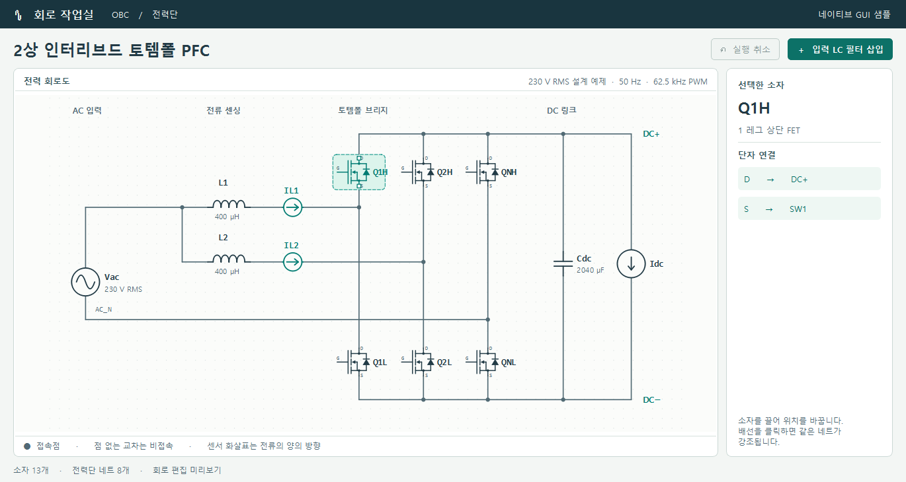

# 사람이 보는 회로와 AI가 편집하는 회로

2026-11-25 · 설계 탐색 및 선행 GUI 시제품 기록

## 단자 연결과 도면 배치

전력 단자는 같은 전기적 네트에 속하는 단자 집합으로 표현한다. 제어 신호에는 송신·수신 포트와 샘플 시각이 있다. 전류 프로브는 가지와 양의 방향, 전압 프로브는 두 노드와 극성을 참조한다. 화면 좌표, 배선 꺾임점, 선택 상태는 도면 정보로 따로 보존한다. 사람이 기호를 옮기면 좌표가 바뀌고, 단자를 다른 네트에 배선할 때 회로가 바뀐다.

전력단에는 수평 DC 버스, 수직 상·하단 FET, 병렬 상의 대칭을 살린다. 제어 블록에는 신호 흐름과 서브시스템 계층이 읽히는 배치가 적합하다. AI는 “분기점 왼쪽에 필터를 넣고 두 레그는 고정”처럼 대상과 상대 위치를 지정한다. 배치기는 편집한 영역의 직각 배선을 조정한다.

## 선행 시제품에서 확인한 동작

별도 Windows 시제품은 PySide6와 Qt의 벡터 그리기로 구현했다. 배선 클릭으로 같은 네트와 연결 단자를 강조하고, 소자 이동·값 편집·입력 LC 필터 삽입·실행 취소를 확인했다. 필터 삽입은 사전에 작성한 편집 명령이다. 여섯 FET는 드레인 위, 소스 아래, 게이트 왼쪽의 N채널 기호이며 소스에서 드레인으로 향하는 바디 다이오드를 표시한다. 자유 배선·AI 호출·솔버 연결은 후속 검증 대상이다.

## 첫 AI 편집 시험

엔지니어가 L1과 브리지 중점 사이의 선을 선택한다. AI가 그 가지에 전류 센서를 직렬로 삽입하면 코어는 기존 직결 구간 제거, 센서 양단 재연결, 양의 방향 설정을 하나의 변경으로 적용한다. 실패하면 직전 회로를 보존한다. 결과 도면에서 센서 우회 경로가 사라졌는지, 해당 상의 전류 피드백이 올바른 측정량을 읽는지 확인한다. 필터 시험에서는 측정 방향에 맞춰 `i_grid = i_L1 + i_L2 + i_Cf`를 검사한다.

MathWorks의 Simulink Agentic Toolkit은 블록·포트 ID를 이용한 편집, 물리 포트의 분기·연결 해제, 선택한 범위의 재배치를 공개했다. 리츠심에서도 GUI 선택과 AI 도구가 같은 ID를 참조하고, 실제 편집 전후의 연결을 비교해 변경 내역을 제시하는 방식을 검토한다. [Simulink 편집 도구 명세](https://github.com/matlab/simulink-agentic-toolkit/blob/bdfaf9ac37876dc38276325a6b2919fa522b33c7/tools/registry.json)
