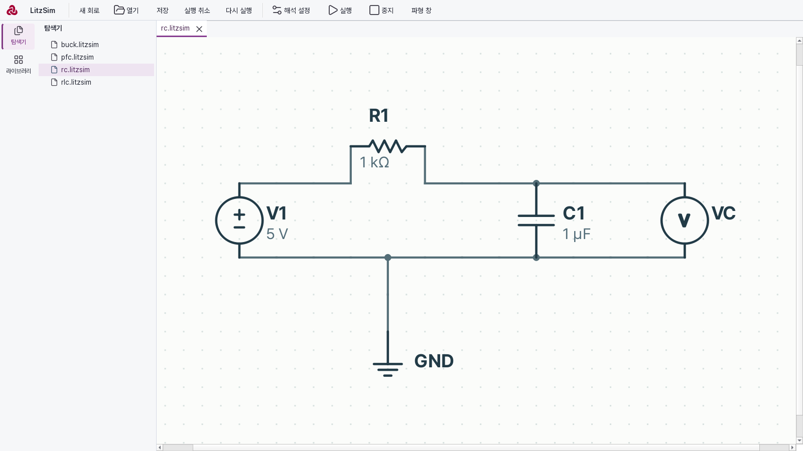
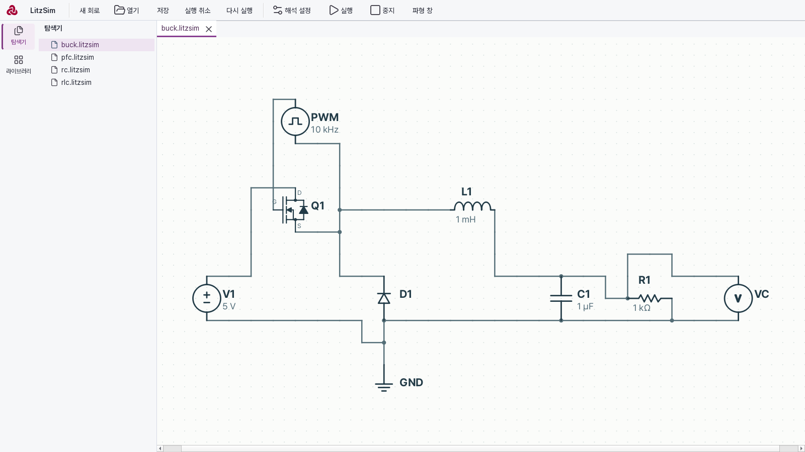
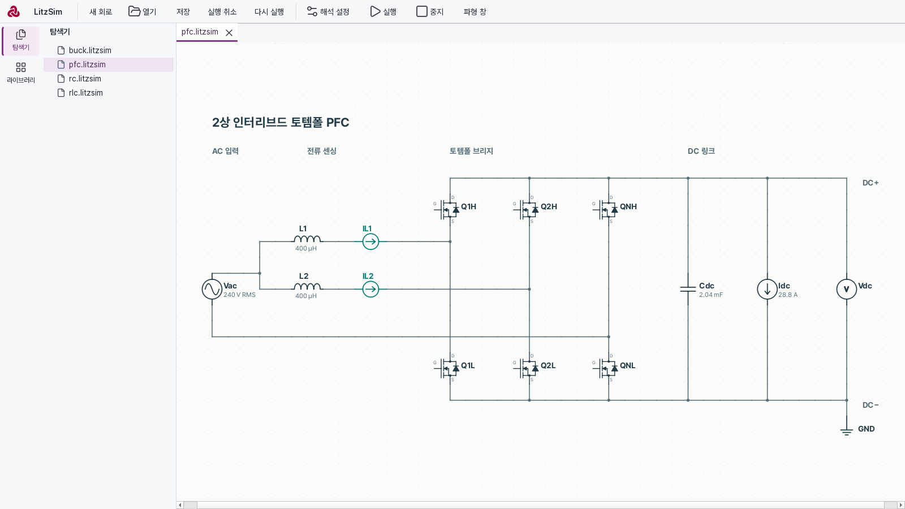

# 논문용 회로도 품질 조사

[이슈 #13](https://github.com/litzio/litzsim/issues/13) · 기준 커밋 `f6dc381` · 2026-11-25

현재 편집기는 RC·벅·2상 토템폴 PFC의 전력 경로와 분기점을 그린다. 논문에 넣으려면 그림만 보고도 네트의 연결, 측정 극성, PFC 게이트의 제어 방식을 읽을 수 있어야 한다. 특히 벅의 게이트 라벨과 배선이 겹치고, PFC는 현재 글자 비율로 두 단 폭에 맞춰도 MOSFET 단자명이 약 3.4 pt다. 배치와 기호의 의미부터 검증하고 최종 크기에 맞춘 벡터 출력을 마련한다.

## 실제 편집기 렌더링

Windows 11 Pro(빌드 26200), MSYS2 UCRT64 Release, Qt 6.10.1 Widgets `offscreen`, 1600×900 논리 픽셀, DPR 1, 96 DPI, 기본 밝은 색상과 Pretendard Variable을 사용했다. 세 화면 모두 탐색기를 펼치고 해당 예제 탭만 연 상태다. 소자와 네트의 선택을 비운 상태에서 Qt 위젯을 원본 크기로 캡처했다.

재현은 README의 Release 빌드를 사용한다. [기존 PFC 캡처 방식](../../tests/pfc-studio.cpp#L16-L37)과 같이 `litzstudio`에 링크한 임시 실행 파일에서 예제별로 `Studio(examplesDir)` → `open(path)` → `resize(1600, 900)` → `show()` → `QApplication::processEvents()`를 호출했다. `scene()->itemsBoundingRect()`에 사방 50 씬 단위 여백을 두고 `fitInView(..., Qt::KeepAspectRatio)`와 `centerOn(bounds.center())`를 적용한 뒤 이벤트를 처리하고 `studio.grab().save(...)`로 저장했다. 실행 환경은 `QT_QPA_PLATFORM=offscreen`, `QT_SCALE_FACTOR=1`, `QT_FONT_DPI=96`이다. 전체 맞춤 배율은 RC 2.311×, 벅 1.376×, PFC 0.877×다.

### RC

[예제 회로](../../examples/rc.litzsim)의 R1·C1 값과 C1 위아래의 접속점이 원본 캡처에서 읽힌다. 오른쪽 `VC`는 원 안의 V로 전압 측정임을 알 수 있지만 어느 쪽이 양의 단자인지 도면에 표시되지 않는다. 파일에서 `VC.p`는 `output`, `VC.n`은 `ground`이며 해석기는 p에서 n을 뺀 전압을 보고한다. 가운데 R1의 양단을 한 격자씩 내리는 배선은 같은 입력·출력 경로를 읽는 데 꺾임 두 쌍을 더한다. [프로브 단자 정의](../../src/circuit.cpp#L24-L27) · [전압 계산](../../src/solver.cpp#L207-L211) · [기호 그리기](../../src/schematic.cpp#L34-L73)

### 벅

왼쪽 위 PWM에서 Q1 게이트로 내려오는 선이 Q1 위쪽 입력선과 격자 `(3, -1)`에서 교차한다. 여기에는 접속점이 없고, [예제 회로](../../examples/buck.litzsim)에서 `gate`와 `input`은 별개 네트다. 교차 바로 아래에서는 같은 세로선이 Q1의 작은 `G` 글자에 겹친다. 라우터는 13px 이상 라벨의 영역을 피하지만 MOSFET 단자 라벨은 9px이다. 오른쪽 출력의 R1 왼쪽 접속점에서 VC로 가는 선은 위로 올라갔다가 다시 내려오고, 하단 V1 귀환선은 D1·GND 쪽에서 한 격자 우회한다. 파일의 접속 관계를 보존하면서 이 구간의 꺾임을 줄일 수 있는지 검토한다. RC와 마찬가지로 오른쪽 `VC`의 극성이 표시되지 않는다. [단자 라벨 배치](../../src/schematic.cpp#L106-L118) · [배선 회피 조건](../../src/schematic.cpp#L208-L224) · [분기점 렌더링](../../src/schematic.cpp#L330-L337)

### 2상 토템폴 PFC

입력, 전류 센싱, 브리지, DC 링크가 왼쪽에서 오른쪽으로 구분된다. 다만 중앙에서 `SW1`과 `SW2`가 `(15, 7)`에서, 아래쪽 `AC_N`이 `SW1`과 `SW2`를 각각 `(15, 10)`, `(20, 10)`에서 점 없이 가로지른다. 세 곳 모두 별개 네트다. 비교할 실제 접속점은 `IL2` 오른쪽의 `SW2` T자와 `QNH`·`QNL` 사이의 `AC_N` T자다. 격자 점과 얇은 선이 함께 보이는 전체 맞춤 화면에서는 교차와 분기를 집중해서 읽어야 한다. [예제 네트](../../examples/pfc.litzsim#L79-L125) · [교차 허용 조건](../../src/schematic.cpp#L158-L182) · [분기점 렌더링](../../src/schematic.cpp#L330-L337)

브리지의 작은 D/G/S와 오른쪽 Vdc의 극성 표기가 문제다. D/G/S는 9px 씬 글자이며 Vdc에는 +/−가 없다. IL1·IL2의 화살표는 남길 수 있으므로 청록색을 제거해도 전류 방향을 전달할 수 있다. MOSFET 여섯 개의 G 단자는 화면에 열린 끝으로 보인다. 예제의 `control.gateSignals`와 PFC 해석기의 매핑을 확인하면 제어기가 구동하는 단자이므로, 논문 그림에서는 제어 연결이나 그 의미를 밝히는 표기가 필요하다. [기호와 라벨](../../src/schematic.cpp#L54-L73) · [단자 글자 크기](../../src/schematic.cpp#L106-L118) · [제어 매핑](../../examples/pfc.litzsim#L193-L221) · [해석기 매핑 검증](../../src/pfc.cpp#L21-L59)

세 PNG에서 배선 경로 경고는 보이지 않았다. 벅과 PFC의 교차 좌표는 씬의 선 항목을 네트 ID별로 모아 격자 좌표에서 대조했다. 세 화면 모두 도구 모음, 탐색기, 탭, 격자, 스크롤바를 포함한다. [화면 변경 검토 기준](../mvp.md#화면-변경-검토)의 단자·측정 방향과 대표 회로 배치를 적용했다. 이 조사는 현재 렌더링을 기록하는 문서 변경이다. 리치오 화면과의 비교, Windows 네이티브 제목줄과 고DPI, 실제 인쇄 및 출판본은 미검증이다.

## 출판 판단에 쓰는 근거

- **기호** — IEEE/ANSI 315-1975는 전기·전자 도면의 기호와 참조 지정 문자를 다루며 IEEE SA에서 `Inactive-Reserved`로 표시한다. IEC 60617 DB는 IEC의 공식 전기기술 도면 기호 데이터베이스다. RC와 벅의 저항은 지그재그형이며, KiCad는 IEC 방식의 사각형 저항을 예제로 소개한다. 문서에 적용한 기호 체계를 명시하고 저항, L/C, 전원, 기준 접지, 다이오드, NMOS 및 바디 다이오드의 모양과 단자 대응을 그 체계에 맞춰 확인한다. PWM과 전류 센싱처럼 해석 동작을 보여주는 기호에는 의미와 단자 방향을 명시한다. 이번 조사에서는 공개 설명을 근거로 삼았으며 기호별 원문 대조와 적합성 판정은 후속 작업이다. [IEEE SA 315-1975](https://standards.ieee.org/ieee/315/515/) · [IEC 60617 DB](https://webstore.iec.ch/en/publication/2723) · [KiCad 시작 안내](https://docs.kicad.org/9.0/en/getting_started_in_kicad/getting_started_in_kicad.html)
- **배선과 접속** — KiCad는 접속점을 찍은 교차를 연결로 해석하며, 점이 없는 교차는 비접속으로 읽는다. 또한 선 굵기와 접속점 크기를 설정하고 Plot에서 최소 선 굵기를 지정할 수 있다. LitzSim은 실제 분기에 채운 점을 쓰고, 비접속 교차는 우선 배치로 줄이며 남은 경우 한 가지 표기 관례를 일관되게 적용한다. [KiCad Wire Junctions](https://docs.kicad.org/9.0/en/eeschema/eeschema.html#wire-junctions) · [KiCad Plotting](https://docs.kicad.org/9.0/en/eeschema/eeschema.html#plotting)
- **글꼴과 최종 크기** — IEEE Author Center의 일반 안내는 단 폭 88.9 mm / 182 mm, 그림의 최종 글자 약 9–10 pt, Helvetica·Arial·Times New Roman·Cambria·Symbol 등의 글꼴과 PDF의 글꼴 임베딩 또는 윤곽선 변환을 안내한다. IEEE Transactions on Power Electronics(TPEL)의 최종 파일 체크리스트는 인쇄 크기에서 최소 8 pt와 최대 폭 7 1/16 in(약 179 mm)을 제시한다. 한글과 Ω·µ·− 같은 문자는 선택한 출력 글꼴에서 지원하는지도 확인한다. [IEEE Resolution and Size](https://journals.ieeeauthorcenter.ieee.org/create-your-ieee-journal-article/create-graphics-for-your-article/resolution-and-size/) · [IEEE File Formatting](https://journals.ieeeauthorcenter.ieee.org/create-your-ieee-journal-article/create-graphics-for-your-article/file-formatting/) · [TPEL 최종 파일 체크리스트, 2쪽](https://www.ieee-pels.org/wp-content/uploads/2025/11/REV-Nov-2025-TPEL-Checklist-and-Guidelines-for-Submitting-Final-Files-for-Paper-Publication.pdf#page=2)
- **색과 내보내기** — KiCad Plot의 SVG·PDF, 흑백, 도곽 제외 옵션을 회로 그림 출력의 참고로 삼는다. SVG는 편집용 원본, 벡터 PDF는 제출 후보로 둔다. IEEE Author Center의 일반 제출 형식 목록에는 SVG가 없으며 래스터 제출 시 컬러·회색조는 300 dpi 초과, 흑백 선화는 600 dpi 초과를 안내한다. TPEL은 회색조에서도 구별되는 라벨과 패턴을 요구하는 방향으로 안내한다. 제출 파일은 대상 학회의 최신 요구에 맞춘다. [KiCad Plotting](https://docs.kicad.org/9.0/en/eeschema/eeschema.html#plotting) · [IEEE File Formatting](https://journals.ieeeauthorcenter.ieee.org/create-your-ieee-journal-article/create-graphics-for-your-article/file-formatting/) · [IEEE Resolution and Size](https://journals.ieeeauthorcenter.ieee.org/create-your-ieee-journal-article/create-graphics-for-your-article/resolution-and-size/) · [TPEL 최종 파일 체크리스트, 2쪽](https://www.ieee-pels.org/wp-content/uploads/2025/11/REV-Nov-2025-TPEL-Checklist-and-Guidelines-for-Submitting-Final-Files-for-Paper-Publication.pdf#page=2)

## 구현 차이와 후속 검증

P0는 연결과 측정 의미를 정확히 전달하는 데 필요한 작업, P1은 출판용 출력의 인수 기준, P2는 래스터 제출이 필요한 경우의 작업이다. 수치는 초기 검증에 쓸 LitzSim 제안값이다.

| 우선 | 항목 | 현재와 차이 | 후속 인수 검증 |
| --- | --- | --- | --- |
| P0 | 기호와 단자 의미 | [기호](../../src/schematic.cpp#L27-L73)는 Qt 경로에 직접 정의된다. 저항 지그재그·L/C·접지·NMOS 도형이 있으며, 전압 프로브 극성과 PFC의 제어기 구동 표기는 없다. | 선택한 규격과 판본으로 기호·참조명·단자 대응표를 검토한다. 회전 0/90/180/270°에서 단자와 표기가 함께 대응하는지 확인한다. RC/벅의 VC와 PFC의 Vdc에서 `V(p)−V(n)`, IL1/IL2에서 p→n, 브리지에서 여섯 `control.gateSignals` 매핑을 파일을 기준으로 대조한다. |
| P0 | 분기·비접속 교차와 배선 | [현재 라우터](../../src/schematic.cpp#L158-L182)는 다른 네트의 직교 교차를 허용하고 [분기 렌더링](../../src/schematic.cpp#L330-L337)은 점을 찍는다. 벅 Q1 게이트의 글자와 선이 겹치고 PFC에는 비접속 교차가 세 곳 있다. | RC·벅·PFC와 T자 분기·비접속 X자 교차가 나란히 있는 시험 회로를 확인한다. 각 연결을 도면에서 따라가 공통 코어의 네트와 대조한다. 지정 교차에서 점이 생기거나 빠지지 않는지, 소자 몸체·라벨 관통, 다른 네트의 평행선 중첩, 숨은 접점이 없는지 검사한다. 벅의 출력과 하단 귀환에서 줄일 수 있는 꺾임을 전후 도면으로 검토한다. |
| P1 | 최종 선 굵기·접속점 | [기호](../../src/schematic.cpp#L200-L203)는 1.6/2, [기본 배선](../../src/schematic.cpp#L265-L270)은 1.8, [접속점](../../src/schematic.cpp#L333-L335)은 지름 6의 씬 단위다. 최종 인쇄 폭에 따른 굵기 규칙이 없다. | 가능한 최종 폭에서 기호와 배선 0.18–0.25 mm, 접속점 지름 0.60–0.80 mm 및 이웃 선 굵기의 2.5배 이상을 초기 목표로 시험한다. PDF의 길이와 획 굵기를 확인하고 실물 크기 흑백 출력에서 MOSFET 채널·바디 다이오드·교차·T자 점이 구별되는지 본다. |
| P1 | 글꼴·크기·라벨 배치 | [라벨](../../src/schematic.cpp#L92-L118)은 Pretendard 기반 ID 16, 값 13, MOSFET 단자 9px이며 주석과 제목은 [별도로 고정 배치](../../src/schematic.cpp#L340-L350)된다. | RC 88.9 mm, 벅 88.9 mm와 두 단 폭, PFC 두 단 폭에서 최종 9–10 pt를 목표로 한다. TPEL을 대상으로 하면 작은 글자도 최소 8 pt로 확인한다. 한 단이나 두 단에 맞추기 어려우면 배치 또는 부분 그림을 검토한다. 격자에 맞춰 소자를 움직이거나 회전한 뒤 ID·값·단자명·주석이 기호·선·다른 글자와 겹치지 않는지 검사한다. 다른 PC에서도 한글·Ω·µ·−와 글자 위치가 유지되는지 확인한다. |
| P1 | 색과 흑백 | [편집기 배경과 격자](../../src/schematic.cpp#L433-L438), [전류 프로브 색·선택 강조·단자 핸들](../../src/schematic.cpp#L198-L224)이 편집 화면에 포함된다. | 흰 배경에 검은 획을 쓰는 출판 기본값을 시험한다. 전력·제어·측정 구분이 필요한 경우 선 종류·기호·텍스트를 사용한다. 선택·확대 상태와 무관하게 같은 그림이 나오는지 확인하고, 회색조 변환과 흑백 실물 출력에서 두 검토자가 네트·극성·게이트 역할을 각각 같은 의미로 읽는지 대조한다. |
| P1 | SVG/PDF와 경계 | [Studio 저장](../../src/studio.cpp#L74)은 회로 파일용이며 공개 편집 경로에서 도면 SVG/PDF 내보내기를 확인하지 못했다. 현재 증거는 Qt 위젯 PNG다. | 같은 회로에서 SVG와 PDF를 내보내고 문서 삽입 및 별도 뷰어에서 확인한다. SVG에는 벡터 경로 또는 텍스트와 적정 `viewBox`가 있고, PDF에서는 페이지 폭·여백·글꼴 임베딩 또는 윤곽선을 확인한다. SVG에 전체 그림 비트맵이 포함되거나 PDF가 화면 캡처 한 장으로 구성되지 않았는지 파일 구조를 검사한다. 작은 라벨과 외곽 획까지 여백 안에 들고 편집 UI와 격자가 빠져야 한다. |
| P2 | 래스터 대체 | PFC 원본 캡처에서 그림 폭은 약 1197 px이다. 182 mm에 넣으면 약 167 dpi다. | 출력 너비에서 직접 렌더링한다. 600 dpi 초과 선화 기준이라면 3.5 in 폭에서 최소 2101 px, 7.16 in 폭에서 최소 4297 px인 원본을 사용한다. 파일의 픽셀 폭을 최종 인쇄 폭(in)으로 나누고, PNG 또는 TIFF를 투고 지침에 맞춰 제출한다. |

크기 추정은 장면 너비 450(RC), 834(벅), 1366(PFC)로 계산했다. 현재 글자 비율과 그림 전체를 유지하면 명목 크기는 `글자 씬 크기 × 목표 폭(in) × 72 / 그림 씬 폭`이다. RC 값 라벨 13px는 3.5 in에서 약 7.3 pt, 벅 단자 라벨 9px는 같은 폭에서 약 2.7 pt, PFC 단자 라벨 9px는 7.16 in에서도 약 3.4 pt다. 실제 글리프 높이와 실물 인쇄 결과는 후속 출력에서 확인한다.

후속 구현에서는 출판 화면과 편집 화면이 공통 코어의 단자·네트·측정 방향을 함께 사용해야 한다. 출판용 배치와 표기에서 원본 예제의 전기적 연결과 제어 매핑이 보존되는지를 먼저 비교한다.

## 소유자가 정할 것

| 결정 | 선택지와 근거 | 추천안 |
| --- | --- | --- |
| 기호 체계 | **IEEE 315 계열**의 지그재그 저항은 현재 RC·벅과 같은 형태라 기존 그림과 비교하기 쉽다. **IEC 60617 계열**의 사각형 저항은 IEC 방식의 기호를 쓰는 문서와 통일할 수 있다. 어느 쪽이든 기호별 원문과 단자 대응을 대조해야 한다. | 첫 출판용 그림은 **IEEE 315 계열**로 통일한다. 적용할 판본과 해석 전용 기호의 예외를 기록한다. |
| 출판 출력 방식 | **편집 화면과 같은 렌더링에서 편집 UI를 끄는 방식**은 같은 기호·배선 배치를 확인할 수 있다. **별도 출판용 렌더링**은 단 폭에 맞춰 배치를 달리할 수 있고, 화면과 그림의 연결·주석이 일치하는지 추가 대조가 필요하다. | **같은 렌더링**을 사용한다. 편집 UI와 격자를 숨기고 출력 시 흑백·물리 크기를 지정한다. PFC의 두 단 폭 검증에서 실제로 배치가 막히면 별도 출판 배치를 다시 검토한다. |
| 비접속 교차 | **점 없는 직교 교차**는 현재 편집기와 KiCad의 관례를 유지한다. **점프 반원**은 비접속에 별도 모양을 부여하며, 좁은 간격에서는 호가 인접 배선이나 라벨을 침범할 수 있다. | **점 없는 직교 교차**를 유지한다. 불필요한 교차를 줄이고, 남은 곳은 흑백 축소본에서 실제 T자 접속점과 구분되는지 확인한다. |

## 구현 PR 분할

아래 세 PR은 각 단계의 결과를 독립적으로 검증할 수 있게 나눈다. 기호 체계와 교차 표기는 소유자 결정에 맞춰 확정한다.

| 순서·범위 | 고칠 파일 | 완료 기준 | 예상 위험과 파일 중복·순서 |
| --- | --- | --- | --- |
| 1. 기호·단자·측정 표기 (P0) | `src/schematic.cpp`, `tests/studio.cpp`, `tests/pfc-studio.cpp` | 선택한 규격과 단자를 대조하고, 0/90/180/270°에서 기호와 단자 위치를 확인한다. RC·벅의 VC와 PFC의 Vdc에 `V(p)−V(n)` 극성, IL1·IL2에 p→n 방향이 보이는지 확인한다. PFC의 여섯 게이트 표기는 기존 `control.gateSignals` 매핑과 대조한다. 세 예제의 전후 캡처와 씬 항목 검사로 근거를 남긴다. | 극성 반전, 단자 불일치, 게이트 주석이 물리 배선으로 읽힐 위험이 있다. PR 2·3과 `src/schematic.cpp`를 공유하므로 먼저 병합해 기호와 라벨의 배치 기준을 확정한다. |
| 2. 배선·라벨 겹침 개선 (P0, P1 라벨 배치) | `src/schematic.cpp`, 필요한 배치·꺾임점에 한해 `examples/buck.litzsim`·`examples/pfc.litzsim`, `tests/workflow.cpp` | 벅 Q1의 G 라벨 겹침을 없애고, RC·벅·PFC 및 T자 분기·비접속 교차 시험을 원본 크기로 캡처한다. 회전·이동 후에도 기호나 라벨이 관통되지 않는지 확인한다. 변경 전후 `nets`, 프로브 단자, PFC 제어 매핑이 동일한지 비교한다. | 라벨 회피가 우회나 미표시 구간을 만들고, 배치 변경이 접점을 숨길 수 있다. PR 1의 라벨 크기와 위치를 기준으로 검사한다. PR 3도 `src/schematic.cpp`의 그리기 코드를 만지므로 이 PR을 먼저 병합한다. |
| 3. 흑백 벡터 그림 내보내기 (P1 선 굵기·글꼴·색·SVG/PDF) | `src/schematic.cpp`, `src/studio.cpp`, `src/studio.h`, `CMakeLists.txt`, `cmake/WindowsRuntime.cmake`(Qt SVG 런타임 배치 변경 시), `tests/studio.cpp` | 같은 회로를 선택·확대 상태를 달리해 내보내고 그림의 일치와 편집 표시 제외를 확인한다. SVG의 벡터 요소·`viewBox`, PDF의 최종 폭·여백·폰트 임베딩 또는 윤곽선, 최종 크기의 글자와 획을 위 차이표 기준으로 검사한다. RC는 한 단, 벅은 한 단과 두 단, PFC는 두 단에서 실물 크기 흑백 출력으로 접속점·교차·극성을 확인한다. | 폰트 대체, 그림 잘림, 출력 배율에 따른 획 손실, Windows SVG 런타임 누락이 위험이다. PR 1과 `tests/studio.cpp`, PR 1·2와 `src/schematic.cpp`를 공유한다. 두 PR이 병합된 도면으로 출력 검증을 한다. |

현재의 구체적 제약은 같은 회로 씬에 핸들과 선택 표시가 있고, 위젯의 배경에는 편집 격자가 그려진다는 점이다. 내보내기에 필요한 표시만 제어하는 것부터 시작한다. 같은 기호·배선으로 목표 크기를 충족하지 못한 사례가 재현되면 해당 예제와 실패 기준을 근거로 별도 배치 방식을 검토한다.

## 이슈 15 기호와 측정 표기

IEEE Std 315-1975(1993 재확인)의 기호 도판을 기준으로 아래 형태를 적용했다. 아래쪽과 왼쪽 등의 단자 위치는 0° 기준이다. 격자 단자를 고정한 상태에서 NMOS 본체를 높이고 다른 기호와 같은 씬 단위 2의 획을 적용했다. 기호·배선·접속점·라벨은 기본 검정이다. 선택 강조와 단자 핸들에는 편집용 색을 유지한다. [IEEE 315-1975](https://standards.ieee.org/ieee/315/515/) · [IEEE 315A-1986](https://standards.ieee.org/ieee/315A/516/)

| 기호 | 도형 근거 | 단자 대응과 LitzSim 표기 |
| --- | --- | --- |
| 저항 | 2.1.1 지그재그 | 왼쪽 p, 오른쪽 n |
| 인덕터 | 6.2.1의 연속 호 계열 | 왼쪽 p, 오른쪽 n. 일반 인덕턴스 모델에는 코어를 표시하지 않는다. |
| 커패시터 | 2.2.1 Style 1 평행판 | 위 p, 아래 n |
| 직류 전압원 | 2.5.1 일반 직류원 | 긴 위판 p, 짧은 아래판 n |
| 교류 전압원 | 2.7 원 안의 정현파 | 위 p, 아래 n |
| 기준 접지 | 3.9.1의 짧아지는 평행선 | 위 ref. 해석의 기준 노드에 사용한다. |
| 다이오드 | 8.5.1의 방향과 캐소드 막대 | 아래 애노드 a에서 위 캐소드 k를 향한다. |
| N채널 MOSFET | 8.6.10.5의 절연 게이트·분절 채널·기판 화살표와 8.6.10.3의 소스 기판 연결 | 위 D, 왼쪽 G, 아래 S. 내부 기판을 S에 연결하고 S에서 D로 향하는 바디 다이오드를 병렬로 그린다. |
| PWM | 2.7의 원형 전원 도형을 응용한 해석 기호 | 원 안에 펄스를 그린다. 위 out, 아래 ref와 벅의 물리 배선으로 연결한다. |
| 전압 프로브 | 12.1의 원형 V에 해석 극성 추가 | `+`는 p, `−`는 n이며 `V(p)−V(n)`을 읽는다. |
| 전류 센서 | 12.1의 원형 A에 해석 방향 추가 | 내부 화살표는 p→n 기준이다. |
| 전류 싱크 | 원과 화살표를 결합한 해석 기호 | 위 p에서 아래 n으로 향하는 부하 전류를 그린다. |
| 제어기 게이트 주석 | LitzSim 해석용 텍스트 | `제어 high1`처럼 G 옆에 붙인다. 공통 코어의 `control.gateSignals`에서 표시할 신호명을 읽으며, 주석에 선이나 접속점을 붙이지 않는다. |

전압 프로브의 +/−는 22 씬 px 굵은 글자다. MOSFET의 D/G/S는 값 라벨과 같은 13 씬 px 보통 굵기다. 두 표기 모두 각 단자에 가까운 기호 바깥쪽에 놓는다.

Windows Qt `windows` 플랫폼에서 선택을 비운 Studio 창 콘텐츠를 전후 각각 1600×900 px, DPR 1, 논리 DPI 96으로 캡처했다. 씬 경계에 50씬 단위의 여백을 더해 전체 맞춤을 적용했다. 네트 ID와 선분 양 끝의 씬 좌표를 비교해 총 274개 배선 선분이 전후에 일치함을 확인했다. 벅과 PFC의 비접속 교차는 #16에서, 실물 크기와 내보내기는 #17에서 검증한다.

| 예제 | 변경 전 | 변경 후 |
| --- | --- | --- |
| RC | [캡처](assets/schematic-ieee-rc-before.png) | [캡처](assets/schematic-ieee-rc.png) |
| 벅 | [캡처](assets/schematic-ieee-buck-before.png) | [캡처](assets/schematic-ieee-buck.png) |
| 2상 토템폴 PFC | [캡처](assets/schematic-ieee-pfc-before.png) | [캡처](assets/schematic-ieee-pfc.png) |
