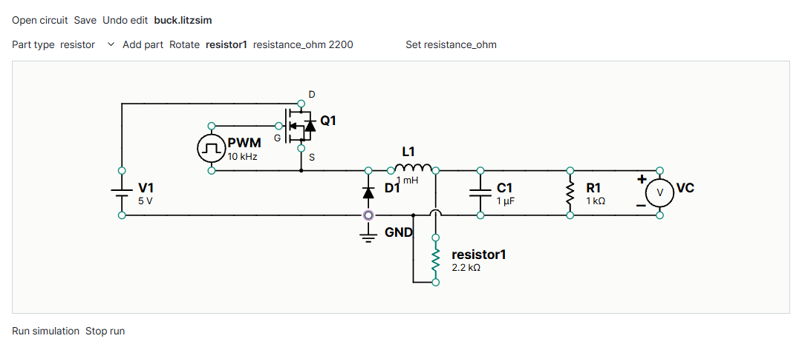
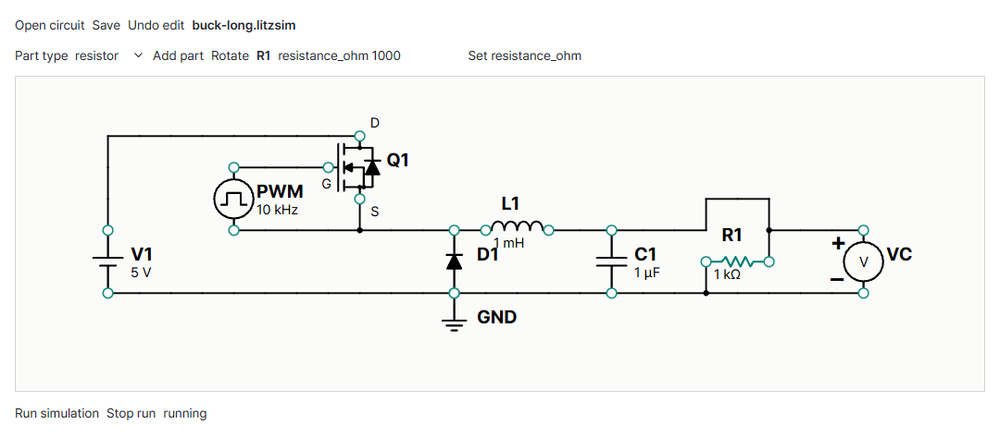
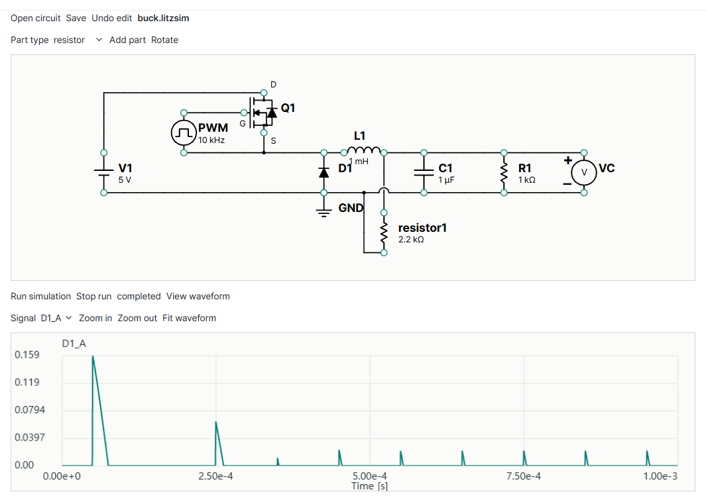

# Litzio에서 LitzSim 회로 편집·실행·파형 보기

2026-11-26 · 이슈 [#25](https://github.com/litzio/litzsim/issues/25) · 시제품 `spike/25-litzio-plugin` [`e6f38f29b4e4629bea8f02eb2051f9384ae8b011`](https://github.com/litzio/litzsim/commit/e6f38f29b4e4629bea8f02eb2051f9384ae8b011)

**판정은 상주 코어 방식에서 통과.** RC와 벅의 회로 편집·저장·실행·중지·파형을 Litzio Host와 단독 브라우저에서 확인했다. 매회 CLI를 새로 시작하면 드롭과 연결의 p95가 두 환경 모두 100ms를 넘었다. 화면과 호출 형식을 유지하고 Qt 코어 프로세스를 플러그인과 로컬 서버 수명 동안 재사용하면 기준 안에 들어왔다.

## 검증 조건

- Windows 11 Pro 26200, AMD Ryzen 5 5600X, RAM 32 GiB, SSD, MSYS2 UCRT64 Release. Chrome 158.0.8127.37의 같은 persistent 프로필에서 Litzio UI와 단독판을 순서대로 실행했다. 1440×900 CSS px, 밝은 테마, Litzio 셸 한국어, 시험 화면 영어. 배율 1×. 시간 계측은 headless로, 문서 캡처는 같은 프로필을 재사용해 화면을 표시한 Chrome 창에서 수행했다.
- Litzio 공식 Windows 0.0.4-beta.2 배포물(0598b25e1561)을 추출해 동봉 CLI의 production HTTP Host를 로컬로 실행했다. Host 데이터와 열린 폴더는 이번 시험 전용으로 격리했다. 플러그인 설정의 절대 실행 파일 위치에서 LitzSim CLI를 실행했고 설치·설정 적용·reload·제거를 실측했다. Litzio Desktop 창에서의 실행은 미검증이다. 별도로 남아 있던 Litzio 체크아웃의 기존 CLI 빌드는 플러그인 SDK 런타임 파일 없이 활성화에 실패했다. 해당 체크아웃은 읽기 전용으로 두고 공식 배포물로 전환했다.
- RC 기준 배치에 시험 저항 하나를 추가했다. 드래그 드롭 확정과 저항 단자를 기존 출력 네트에 붙이는 두 번째 단자 선택을 각각 50회 했다. 각 편집 후 Undo로 동일 revision을 복원했다. 드래그 포인터 이동은 5단계, 두 단자 선택 간격은 120ms, 편집과 Undo 전후 간격은 130ms다. 입력 핸들러 진입부터 확정 기하가 렌더링되는 프레임까지 재고, 다음 animation frame에서 해당 프레임 경계를 확인했다. 포인터 이동 중 임시 표시와 Undo 시간은 제외했다.

## 편집 왕복

각 칸은 밀리초 p95다. Host/HTTP·브리지 구간은 화면 호출에서 Node handler를 뺀 값이다. CLI 기타에는 프로세스 시작·Qt 초기화·입출력·종료가 포함된다. 구간마다 p95를 따로 계산했다. 브리지 시간에는 전송 대기와 브라우저의 응답 처리 대기가 함께 포함된다.

| 환경 | 코어 | 입력 | 전체 | Apply | Layout | CLI 전체 | CLI 기타 | Host/HTTP·브리지 | 응답~그리기 |
| --- | --- | --- | ---: | ---: | ---: | ---: | ---: | ---: | ---: |
| Litzio Host | 매회 시작 | 드롭 | 201.0 | 0.32 | 90.69 | 173.56 | 82.55 | 18.11 | 18.30 |
| Litzio Host | 매회 시작 | 연결 | 463.3 | 0.40 | 162.13 | 436.48 | 313.94 | 18.65 | 19.40 |
| Litzio Host | 상주 | 드롭 | 36.0 | 0.24 | 1.60 | 2.36 | 0.60 | 19.01 | 18.20 |
| Litzio Host | 상주 | 연결 | 35.3 | 0.31 | 1.81 | 2.70 | 0.62 | 16.18 | 18.80 |
| 단독 브라우저 | 매회 시작 | 드롭 | 188.2 | 0.31 | 93.59 | 178.81 | 84.94 | 3.62 | 15.30 |
| 단독 브라우저 | 매회 시작 | 연결 | 251.0 | 0.38 | 96.91 | 230.76 | 84.79 | 3.13 | 17.10 |
| 단독 브라우저 | 상주 | 드롭 | 36.2 | 0.25 | 1.56 | 2.33 | 0.58 | 16.16 | 18.50 |
| 단독 브라우저 | 상주 | 연결 | 35.0 | 0.31 | 1.92 | 2.82 | 0.70 | 14.34 | 18.40 |

매회 시작 방식의 Host에서 OS spawn 이벤트까지는 각각 p95 6.13ms, 6.70ms였다. 매회 시작 방식의 Host 예비 50회에서는 전체 p95가 217.2ms, 268.6ms였다. 이후 화면 크기를 고정한 본 계측에서도 두 연산 모두 기준을 넘었고 연결 지연의 편차가 컸다. 첫 `layout`에는 프로세스별 Qt 글꼴 조회와 기하 계산이 함께 잡혔다. 상주 방식은 같은 CLI를 JSON Lines로 호출한다. 같은 C++ `apply`와 배치 코드를 유지했을 때 Host에서 layout이 p95 1.6~1.81ms로 내려갔다. 어떤 Qt 초기화 함수가 시간을 가장 많이 쓰는지는 프로파일링하지 않았다.

## RC·벅 작업 흐름

두 환경에서 저항을 추가·이동·회전해 2.2kΩ으로 바꾸고 양 단자를 출력 및 접지에 연결했다. 저장·다시 열기 revision과 v1 문서를 확인했다. 같은 연산을 한 CLI 배치로 적용한 문서 및 명시한 예상 소자·좌표·네트와 일치했다. 잘못된 revision, 배치 마지막 연산의 없는 단자, 디스크 revision 충돌은 거절됐다. 완료한 파형은 같은 저장본을 기존 CLI로 직접 실행한 결과와 바이트 단위로 일치했다.

장기 실행은 RC와 벅의 복사본에서 종료 시각 10000s, 100s를 각각 지정하고 결과 저장 간격을 해석 스텝의 1000배로 설정했다. 두 회로에서 실행 중 소자를 회전해 확정 revision을 확인했다. 실행기 종료를 확인한 뒤 `canceled`를 표시했고, 디스크에서 해당 실행의 상태와 시작 당시 회로 스냅샷을 확인했다. 아래 RPC 시간은 화면 왕복 각 한 번이며, 상태 시간은 중지 직전의 조회다. 파형은 벅 D1 전류와 RC VC 전압의 첫 표시 및 각 20회 확대·이동의 p95다.

| 환경 | 회로 | 정지 전 실행 (s) | 접수 (ms) | 상태 (ms) | 중지 (ms) | 파형 첫 표시 (ms) | 확대 p95 (ms) | 이동 p95 (ms) |
| --- | --- | ---: | ---: | ---: | ---: | ---: | ---: | ---: |
| Litzio Host | RC | 11.17 | 34.2 | 12.0 | 20.0 | 218.6 | 2.9 | 18.6 |
| Litzio Host | 벅 | 11.19 | 28.1 | 10.7 | 27.1 | 61.4 | 15.6 | 18.0 |
| 단독 브라우저 | RC | 11.19 | 18.2 | 2.5 | 16.4 | 90.7 | 15.2 | 18.5 |
| 단독 브라우저 | 벅 | 11.20 | 19.2 | 2.3 | 16.9 | 69.1 | 15.2 | 18.8 |

아래는 Windows의 실제 Litzio Host 화면 중 플러그인 영역이다. 벅의 MOSFET 단자, 전압계 극성, 분기 접속점과 비접속 교차가 보인다. 파형의 신호명·시간 축·피크를 확인했다. 캡처 때도 벅을 끝까지 재현했다. 화면을 표시한 창에서 파형 첫 표시는 232.8ms, 이동 p95는 18.3ms, 장기 실행 중지는 50.3ms였다.

## 구현 판단과 다음 검증

- 앱 수명의 상주 CLI를 웹 구현의 출발점으로 삼을 수 있다. Qt 편집기와 CLI는 기존 C++ `Circuit` 연산과 같은 배치 함수를 호출한다. 이번 배치 함수는 여전히 `QGraphicsScene`에 기하를 만들고 CLI가 선·점·텍스트·단자 좌표를 JSON으로 내보낸다. 제품 구현에서는 씬과 독립적인 기하 결과 및 이전 경로 힌트의 재사용을 검증한다.
- 실행 ID·상태·스냅샷은 로컬 처리 코드가 맡는다. 플러그인 화면과 독립 화면은 같은 React 소스와 로컬 처리 코드를 사용했다. reload 후 진행 중인 실행의 복구와 비정상 종료 시 자식 정리는 후속 검증 항목이다. 디스크 충돌 시험은 저장 직전 revision 비교이며 외부 쓰기와 동시에 일어나는 경쟁은 미검증이다.
- Canvas는 소규모 파형의 기존 C++ envelope 배열을 받아 확대와 이동을 로컬에서 그린다. 더 확대해도 추가 샘플을 가져오지 않는다. 대량 파형 구간 읽기와 메모리는 #24에서 평가한다. 비서와 문서 통합은 이 실험 범위에서 제외했다.

`cmake -S . -B build -G Ninja -DCMAKE_BUILD_TYPE=Release`, `cmake --build build`, `ctest --test-dir build --output-on-failure`를 실행했다. CTest 10/10 통과. 두 화면 시험과 [재현 안내](https://github.com/litzio/litzsim/blob/e6f38f29b4e4629bea8f02eb2051f9384ae8b011/spike/web/README.md)의 CLI 대조를 실행했다. 시험 플러그인 등록을 제거하고 목록에서 사라진 것을 확인했으며 실행기·Host·단독 서버·브라우저 테스트 세션을 종료했다.
